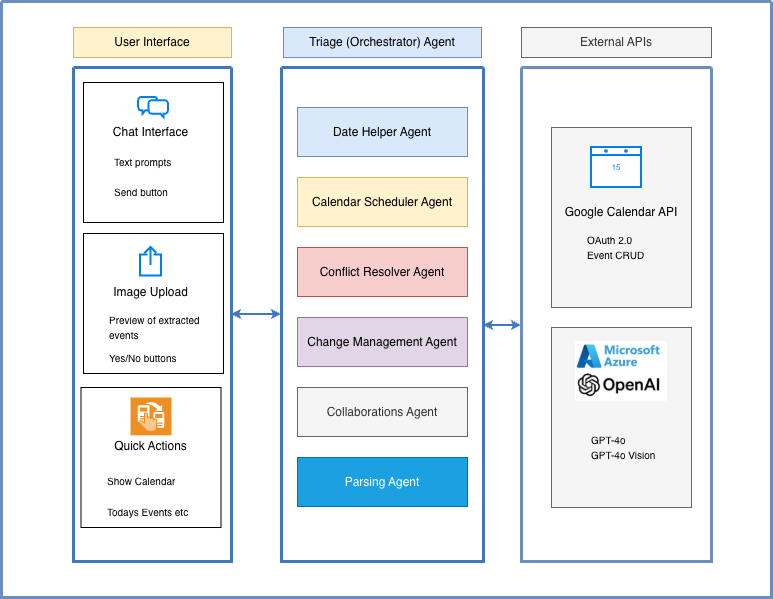

<div align="center">

# Multi-Agent Calendar Management System

### Manage your Google Calendar through conversation

*Six specialised AI agents create, change and organise your events from plain language — and turn a photo of any schedule into calendar entries.*

[](https://github.com/MRafiqAsim/multi-agent-calendar/actions/workflows/ci.yml)
[](pyproject.toml)
[](https://github.com/astral-sh/uv)
[](https://github.com/astral-sh/ruff)

</div>

---

## Overview

A multi-agent calendar management system that combines natural-language understanding with the Google Calendar API. Users create, modify and organise events through conversation, and can extract events from any image of a schedule and add them to their calendar.

**Key capabilities**

- Conversational calendar management — *"Show my calendar for this week"*, *"Move the team meeting to 3pm"*
- Image-based event import — upload a screenshot or photo of a schedule and review the extracted events before adding them
- Conflict detection and resolution
- Human-style date understanding — *"tomorrow"*, *"next Monday"*

## Architecture

The system is built on the [openai-agents](https://github.com/openai/openai-agents-python) library with Azure OpenAI GPT-4o. A triage (orchestrator) agent understands the user's intent and hands the job to a dedicated agent. It has three layers:

- **User interface** — a Gradio app with chat, image upload and quick actions
- **Triage (orchestrator)** — six agents that collaborate to handle each request
- **External APIs** — Google Calendar (OAuth 2.0, event CRUD) and Azure OpenAI (GPT-4o, GPT-4o Vision)

<p align="center">
  
</p>

### Agents

| Agent | Responsibility |
|---|---|
| **Triage (orchestrator)** | Understands the user's input and routes it to the right agent |
| **Calendar Scheduler** | All Google Calendar create, read, update and delete operations |
| **Date Helper** | Parses and calculates dates and times, e.g. turns "tomorrow" into an actual date |
| **Conflict Resolver** | Detects scheduling conflicts and helps resolve them |
| **Collaboration** | Batch operations and multi-event imports |
| **Parsing** | Extracts events from schedule images with GPT-4o Vision |
| **Change Management** | Understands change requests and carries them out |

### Technology stack

| Component | Technology |
|---|---|
| AI framework | openai-agents |
| Language model | Azure OpenAI GPT-4o (text and vision) |
| Calendar | Google Calendar API (OAuth 2.0) |
| Web interface | Gradio |
| Packaging | uv |

### Project structure

```
calendar_agents/
├── orchestrator_agent.py        # Triage agent: intent detection and routing
├── calendar_agent.py            # Calendar Scheduler: event CRUD tools
├── calendar_manager.py          # Google Calendar API client and OAuth
├── date_helper_agent.py         # Relative date and time calculations
├── conflict_agent.py            # Conflict detection and free-slot search
├── collaboration_agent.py       # Batch operations and multi-event import
├── parsing_agent.py             # Event extraction from images (GPT-4o Vision)
├── change_management_agent.py   # Natural-language change requests
├── utils.py                     # Shared helpers
└── config.py                    # Environment configuration and model clients
app.py                           # Gradio web application
main_app.ipynb                   # The same application as a notebook
```

## Getting started

### Prerequisites

- Python 3.11+ and [uv](https://docs.astral.sh/uv/)
- An Azure OpenAI resource with a GPT-4o deployment
- A Google Cloud project with the **Google Calendar API** enabled and an OAuth client ID of type *Desktop app*

### Setup

```bash
git clone https://github.com/MRafiqAsim/multi-agent-calendar.git
cd multi-agent-calendar
uv sync

cp .env.example .env    # then fill in your Azure OpenAI and Google OAuth values
```

### Run as a web app

```bash
uv run python app.py
```

Open http://127.0.0.1:7863. If the port is taken, change `server_port` in the last line of `app.py`.

### Run as a notebook

```bash
uv sync --group notebook
uv run jupyter notebook main_app.ipynb
```

Run all cells; the app starts at http://127.0.0.1:7865 (the port is set in the last cell).

### First run

On first run your browser opens Google's consent screen to grant access to your calendar. The resulting token is saved to `token.pickle` in the project directory and reused afterwards. It is git-ignored — never commit it.

## Configuration

Settings are read from environment variables (`.env`) in `calendar_agents/config.py`:

| Variable | Purpose |
|---|---|
| `AZURE_OPENAI_API_KEY` | Azure OpenAI authentication |
| `AZURE_OPENAI_ENDPOINT` | Azure OpenAI service endpoint |
| `OPENAI_DEPLOYMENT_NAME` | Azure deployment name (default `gpt-4o`) |
| `OPENAI_VERSION_NAME` | Azure OpenAI API version |
| `GOOGLE_CLIENT_ID` | Google OAuth client ID |
| `GOOGLE_CLIENT_SECRET` | Google OAuth client secret |
| `TIMEZONE` | Time zone for events and the app (default `Europe/Brussels`) |

## Using the system

**Chat** — type natural-language commands:

- *"Show my calendar for this week"*
- *"Schedule a meeting with John tomorrow at 10am"*
- *"Move the team meeting to 3pm"*
- *"Cancel the dentist appointment"*
- *"Check for any scheduling conflicts"*

**Import events from an image** — in the *Upload Schedule* panel, choose a screenshot or photo of a schedule and click *Import to Google Calendar*. Review the extracted events, then confirm with *Yes* or discard with *No*.

**Quick actions** — one-click buttons for *Show My Calendar*, *Today's Events*, *Check Conflicts* and *Help*, plus *System Status* under the chat.

## Troubleshooting

| Issue | Solution |
|---|---|
| Google authentication fails | Delete `token.pickle` and restart the app or notebook kernel |
| Azure OpenAI errors | Check the API key, endpoint and deployment name in `.env` |
| Module not found | Run the app through `uv run` so the project environment is used |
| Port already in use | Stop the other instance, or change the port (see above) |

## Development

```bash
uv sync --group dev
uv run pre-commit install
uv run ruff check . && uv run ruff format --check .
```

## Support

Did this assistant save you a few calendar headaches? Help fuel the next release with a [coffee (€5)](https://paypal.me/mrafiq89/5EUR) ☕ — or leave a ⭐ so others can find it too.

---

Shared as a portfolio project. No open-source license is granted; please get in touch before reusing the code.
